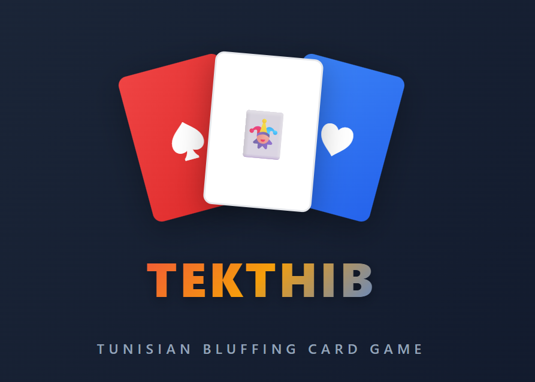

# 🃏 Tunisian Online Card Game - Tekthib

<p align="center">
   
</p>

## 📖 Overview

A real-time multiplayer card game platform that brings the classic Tunisian bluffing card game online. Players can create rooms, invite friends via room codes, and enjoy voice chat while playing this exciting game of deception and strategy.

> **🌐 Live Application**: https://chater-marzougui.me/Tekthib/
> 
> **📚 Documentation**: 
> - [SUPABASE_SETUP.md](./SUPABASE_SETUP.md) - Database and authentication setup
> - [SYSTEM_OPTIMIZATION.md](./SYSTEM_OPTIMIZATION.md) - Performance optimization
> - [MIGRATION_PLAN.md](./MIGRATION_PLAN.md) - WebRTC migration plan

### 🎯 Quick Rules
- **Goal**: Be the first to get rid of all your cards. Last player with cards loses
- **Core Mechanic**: Players place cards face-down and announce a rank (truthfully or lying)
- **Bluffing**: Other players can challenge by calling "Liar!"
- **Consequences**: Wrong challengers or caught liars take the pile
- **Special Rule**: Collect all 4 cards of same rank = permanently removed
- **Setup**: 108 cards (double deck + 4 Jokers), 3-10 players

## 🚀 Features

### ✅ Fully Implemented
- **Game Engine**: Complete server-authoritative game logic with turn-based gameplay
- **Room System**: Create/join rooms with 6-character codes, QR code sharing
- **Real-time Communication**: WebSocket for game state, WebRTC for voice chat
- **AI Bots**: Three personalities (aggressive, truthful, unpredictable) with learning capabilities
- **Timer System**: Configurable auto-play timer (10-120 seconds) with real-time updates
- **Challenge Suspense**: Optional 3-second dramatic reveal with play blocking during challenge processing
- **i18n**: Multi-language support (English, French, Arabic) with RTL for Arabic
- **Voice Chat**: P2P WebRTC audio with host controls (kick, mute) and personal mute
- **Admin Dashboard**: Real-time monitoring of rooms, players, and game states
- **Responsive UI**: Dark/light themes, custom animations, mobile-friendly
- **Database Backend**: Supabase integration for user authentication and game history

### 🚧 Future Enhancements
- Link game history to authenticated users
- Leaderboards and player rankings
- Spectator mode and game replay
- Tournament system
- Custom game modes and rule variations
- Enhanced mobile app experience

## 🏗️ Technical Stack

### Frontend
- **Framework**: React 18 + TypeScript + Vite
- **Styling**: Tailwind CSS + Shadcn UI components
- **Icons**: Iconify
- **i18n**: i18next with multi-language support
- **Real-time**: WebSocket client + WebRTC for voice

### Backend
- **Runtime**: Node.js + Express + TypeScript
- **WebSocket**: ws library
- **Game Logic**: Server-authoritative GameEngine
- **AI**: Bot players with personalities and learning (40+ chat messages)
- **Database**: Supabase (PostgreSQL) for authentication and game history
- **Authentication**: JWT tokens with refresh capability (1-week expiry)
- **Deployment**: Heroku with Procfile

### Architecture
```
┌─────────────┐           ┌─────────────┐
│   Browser   │ <──WS──>  │   Backend   │
│ (React/TS)  │           │ (Node/WS)   │
└──────┬──────┘           └──────┬──────┘
       │                         │
WebRTC │ Signaling via WS        │ In-memory
 Audio │────────────────────────►│ Room State
       │                         │
       ▼                         ▼
  P2P Voice Chat            Server validates
  (Direct connection)        all game actions
```

## 📁 Project Structure

```
Tekthib/
├── README.md                     # This file
├── SYSTEM_OPTIMIZATION.md        # Performance optimization recommendations
├── MIGRATION_PLAN.md             # WebRTC P2P migration strategy
├── BOT_AI_ENHANCEMENT_SUMMARY.md # Bot AI features documentation
│
├── client/                       # Frontend React App (Vite)
│   ├── src/
│   │   ├── pages/                # HomePage, GamePage, RoomPage, AdminPage
│   │   ├── components/           # UI components (game, chat, ui)
│   │   ├── hooks/                # useWebSocket, useVoiceChat, etc.
│   │   ├── context/              # WebSocketContext, VoiceChatContext
│   │   └── lib/                  # Utilities and configs
│   └── public/                   # Static assets
│
├── server/                       # Backend Node.js App
│   ├── src/
│   │   ├── game/                 # GameEngine, BotPlayer, Deck, BotMemory
│   │   ├── websocket/            # WebSocket handlers (room, game, chat, webrtc)
│   │   ├── routes/               # HTTP API routes
│   │   └── utils/                # roomManager and utilities
│   └── Procfile                  # Heroku deployment config
│
├── test/                         # WebRTC Testing Tools
│   ├── browser-test.html         # Browser multi-tab test (recommended)
│   ├── quick-start.sh            # Interactive testing script
│   ├── TESTING_GUIDE.md          # Complete testing documentation
│   └── node/                     # Node.js connectivity tests
│
└── shared/                       # Shared TypeScript types
    └── src/types/                # Game, Player, Room, WebSocket message types
```

## 🚀 Getting Started

### Prerequisites
- Node.js 18+ and npm

### Quick Start

1. **Clone Repository**
```bash
git clone https://github.com/chater-marzougui/Tekthib.git
cd Tekthib
```

2. **Install Dependencies**
```bash
# Install all dependencies (client, server, shared)
npm run install:all
```

3. **Setup Environment Variables**

Create `server/.env`:
```env
PORT=3001
NODE_ENV=development
CORS_ORIGIN=http://localhost:5173

# Optional: Supabase for authentication and game history
SUPABASE_URL=https://your-project.supabase.co
SUPABASE_SERVICE_KEY=your-service-role-key-here
JWT_SECRET=your-secret-key-here
```

Create `client/.env`:
```env
VITE_WS_URL=ws://localhost:3001
VITE_API_URL=http://localhost:3001
```

> **Note**: Supabase configuration is optional. The game works without it, but you won't have user authentication or game history tracking. See [SUPABASE_SETUP.md](./SUPABASE_SETUP.md) for detailed setup instructions.

4. **Start Development Servers**
```bash
# Terminal 1: Start backend
npm run dev:server

# Terminal 2: Start frontend
npm run dev:client
```

5. **Access Application**
- Frontend: http://localhost:5173
- Backend: http://localhost:3001
- Admin: http://localhost:5173/admin (password required)

### Testing WebRTC Voice Chat

Test voice chat from a single computer without needing multiple devices:

```bash
# Quick test with browser (recommended)
# Open test/browser-test.html in your browser
# Click "Start Multi-Tab Test"
# Allow popups and microphone access

# Or use the interactive script
cd test
./quick-start.sh

# Or run connectivity test
cd test/node
npm install
npm run dev-connection
```

📚 **See [test/TESTING_GUIDE.md](./test/TESTING_GUIDE.md) for complete testing documentation**

### Alternative Individual Setup

**Backend:**
```bash
cd server
npm install
npm run dev        # Development mode
npm run build      # Production build
npm start          # Production mode
```

**Frontend:**
```bash
cd client
npm install
npm run dev        # Development server
npm run build      # Production build
```

## 🎮 How to Play

### Creating a Game
1. Open https://chater-marzougui.me/Tekthib/
2. Enter your name (supports English, French, and Arabic)
3. Click "Create New Room"
4. Configure settings:
   - Auto-play timer (optional, 10-120 seconds)
   - Challenge suspense (optional, 3-second dramatic reveal)
   - Max players (3-10)
5. Share room code or QR code with friends
6. Wait for at least 3 players, all mark ready, and host starts game

### During the Game
- **Your Turn**: Select cards and claim a rank (watch the timer!)
- **Bluffing**: Claim any rank, even if you don't have those cards
- **Challenge**: Click "Challenge!" if you think someone is lying
  - With suspense enabled: 3-second dramatic reveal with sound effects
  - Play is blocked for all players during challenge processing
- **Win**: Empty your hand first; last player with cards loses
- **Special Rule**: Collect all 4 of same rank = automatically removed

### Chat & Voice
- Text chat available in lobby and during game
- Voice chat with WebRTC (Chrome, Firefox, Brave, Edge)
- Host can kick players or mute microphones
- Personal mute available for any player

### Bot Players
Add AI bots to fill your room:
- **Aggressive**: Bluffs often, challenges frequently
- **Truthful**: Honest player, rarely bluffs
- **Unpredictable**: Mixed strategy
- Bots learn player behavior and send contextual chat messages

### End Game
- View detailed statistics (bluffs, challenges, etc.)
- Earn titles: 🎭 Master Liar, 🔍 Detective, 😇 Saint, 🤔 False Accuser
- Play again to continue with same players

## 📊 Performance & Optimization

See [SYSTEM_OPTIMIZATION.md](./SYSTEM_OPTIMIZATION.md) for:
- Timer update optimization (99% bandwidth reduction possible)
- WebSocket compression strategies
- Game state update optimizations
- Scalability improvements for 5,000+ concurrent users

## 🔄 WebRTC Migration Plan

See [MIGRATION_PLAN.md](./MIGRATION_PLAN.md) for:
- Chat system migration to P2P (with server fallback)
- Player status indicators via WebRTC data channels
- Safe vs unsafe components for migration
- Phased implementation strategy (8-week plan)

## 🤖 Bot AI System

See [BOT_AI_ENHANCEMENT_SUMMARY.md](./BOT_AI_ENHANCEMENT_SUMMARY.md) for:
- Three distinct bot personalities
- Learning system that adapts to player behavior
- 40+ contextual chat messages
- Memory tracking and risk profiling

## 🔧 Recent Fixes & Improvements

### Challenge Suspense System (Latest)
- **Play Blocking**: Players can no longer play cards while a challenge is being processed during suspense
- **Error Handling**: Clear "Processing Challenge" error message displayed to players who attempt to play
- **State Management**: Added `canPlay` flag to game state for proper UI state management
- Ensures fair gameplay and prevents timing exploits during dramatic challenge reveals

### Host Game Start Fix (Latest)
- **Initial State Delivery**: Host now receives complete `INITIAL_GAME_STATE` message immediately on game start
- **Loading Screen Fix**: Resolves production issue where host would see loading screen until first game update
- **Consistent Experience**: All players now receive identical initial state for seamless game start
- Improves reliability in production environments with network latency

### Core Features
- Server-authoritative game engine prevents cheating
- WebSocket-based real-time communication with automatic reconnection
- WebRTC P2P voice chat with fallback mechanisms
- Bot AI with personality-driven behavior and learning system
- Comprehensive player statistics and title system

## 🤝 Contributing

1. Fork the repository
2. Create feature branch: `git checkout -b feature/amazing-feature`
3. Commit changes: `git commit -m 'Add amazing feature'`
4. Push to branch: `git push origin feature/amazing-feature`
5. Open a Pull Request

### Development Standards
- Follow TypeScript strict mode
- Update documentation for new features
- Test with multiple browsers
- Follow the established project structure

---

## 📞 Support

- **Issues**: Create GitHub issues for bugs
- **Discussions**: Use GitHub discussions for feature requests
- **Documentation**: Check project .md files for detailed guides

Happy coding! 🎮✨
